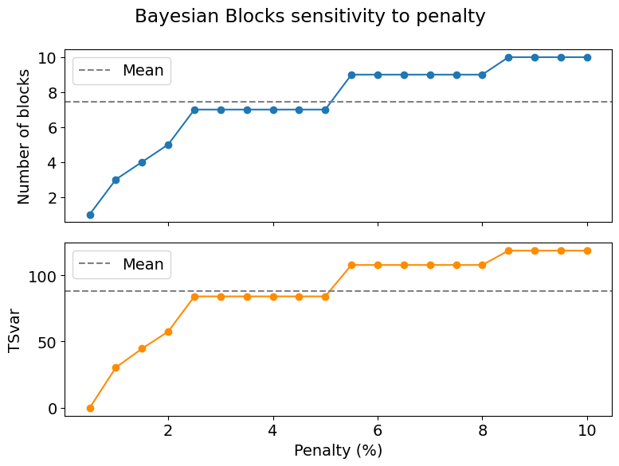

# Penalty - Sensitivity Analysis
This runs multiple instances of the code to partition bayseian blocks with errors ranging from 0.5% to 10%. It then both displays the results on a table and describes the error and plots block count and TSvar against penalty. This can be used to examine the point at which error makes a large jump, if that exists.

<table border="1" class="dataframe">
  <thead>
    <tr style="text-align: right;">
      <th></th>
      <th>penalty_percent</th>
      <th>blocks</th>
      <th>tsvar</th>
      <th>step_ratio</th>
      <th>step_mjd</th>
    </tr>
  </thead>
  <tbody>
    <tr>
      <th>0</th>
      <td>0.5</td>
      <td>1</td>
      <td>0.000</td>
      <td>1.000</td>
      <td>60913.0</td>
    </tr>
    <tr>
      <th>1</th>
      <td>1.0</td>
      <td>3</td>
      <td>30.454</td>
      <td>0.994</td>
      <td>55040.0</td>
    </tr>
    <tr>
      <th>2</th>
      <td>1.5</td>
      <td>4</td>
      <td>44.637</td>
      <td>0.991</td>
      <td>55040.0</td>
    </tr>
    <tr>
      <th>3</th>
      <td>2.0</td>
      <td>5</td>
      <td>57.523</td>
      <td>0.994</td>
      <td>55040.0</td>
    </tr>
    <tr>
      <th>4</th>
      <td>2.5</td>
      <td>7</td>
      <td>84.025</td>
      <td>0.995</td>
      <td>55075.0</td>
    </tr>
    <tr>
      <th>5</th>
      <td>3.0</td>
      <td>7</td>
      <td>84.025</td>
      <td>0.995</td>
      <td>55075.0</td>
    </tr>
    <tr>
      <th>6</th>
      <td>3.5</td>
      <td>7</td>
      <td>84.025</td>
      <td>0.995</td>
      <td>55075.0</td>
    </tr>
    <tr>
      <th>7</th>
      <td>4.0</td>
      <td>7</td>
      <td>84.025</td>
      <td>0.995</td>
      <td>55075.0</td>
    </tr>
    <tr>
      <th>8</th>
      <td>4.5</td>
      <td>7</td>
      <td>84.025</td>
      <td>0.995</td>
      <td>55075.0</td>
    </tr>
    <tr>
      <th>9</th>
      <td>5.0</td>
      <td>7</td>
      <td>84.025</td>
      <td>0.995</td>
      <td>55075.0</td>
    </tr>
    <tr>
      <th>10</th>
      <td>5.5</td>
      <td>9</td>
      <td>107.694</td>
      <td>0.995</td>
      <td>55075.0</td>
    </tr>
    <tr>
      <th>11</th>
      <td>6.0</td>
      <td>9</td>
      <td>107.694</td>
      <td>0.995</td>
      <td>55075.0</td>
    </tr>
    <tr>
      <th>12</th>
      <td>6.5</td>
      <td>9</td>
      <td>107.694</td>
      <td>0.995</td>
      <td>55075.0</td>
    </tr>
    <tr>
      <th>13</th>
      <td>7.0</td>
      <td>9</td>
      <td>107.694</td>
      <td>0.995</td>
      <td>55075.0</td>
    </tr>
    <tr>
      <th>14</th>
      <td>7.5</td>
      <td>9</td>
      <td>107.694</td>
      <td>0.995</td>
      <td>55075.0</td>
    </tr>
    <tr>
      <th>15</th>
      <td>8.0</td>
      <td>9</td>
      <td>107.694</td>
      <td>0.995</td>
      <td>55075.0</td>
    </tr>
    <tr>
      <th>16</th>
      <td>8.5</td>
      <td>10</td>
      <td>118.508</td>
      <td>0.992</td>
      <td>55075.0</td>
    </tr>
    <tr>
      <th>17</th>
      <td>9.0</td>
      <td>10</td>
      <td>118.508</td>
      <td>0.992</td>
      <td>55075.0</td>
    </tr>
    <tr>
      <th>18</th>
      <td>9.5</td>
      <td>10</td>
      <td>118.508</td>
      <td>0.992</td>
      <td>55075.0</td>
    </tr>
    <tr>
      <th>19</th>
      <td>10.0</td>
      <td>10</td>
      <td>118.508</td>
      <td>0.992</td>
      <td>55075.0</td>
    </tr>
  </tbody>
</table>

