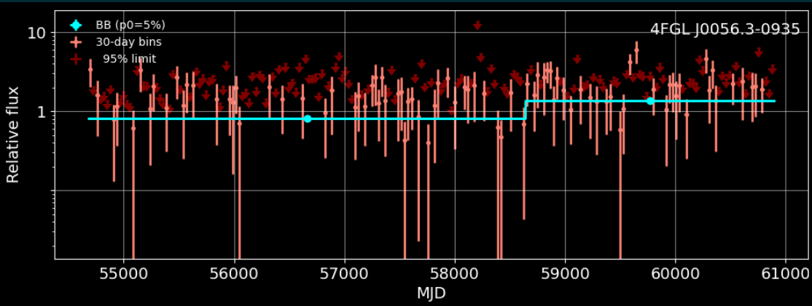
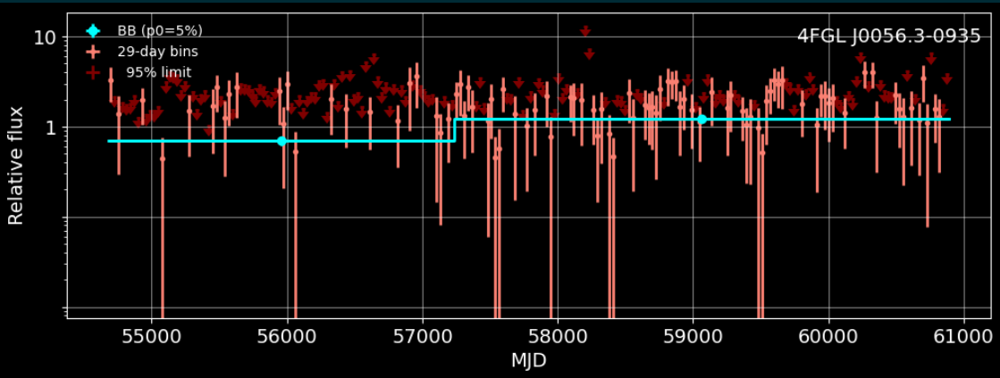

# 11-6-2026

Observed the difference between a 29 and 30 day step light curves:

The step appears about 1000 days earlier in 29 day bins than 30 day bins. The next steps are:

1. Get the actual day value on which the step occurs so that there is a direct comparison
2. Analyze details of the jump: look into what a 29.5 day bin's difference is, along with 30.5 and 31 day. Does it decrease more or less the further out from 30 days? Is it linear? 
3. Analyze reasons for the jump