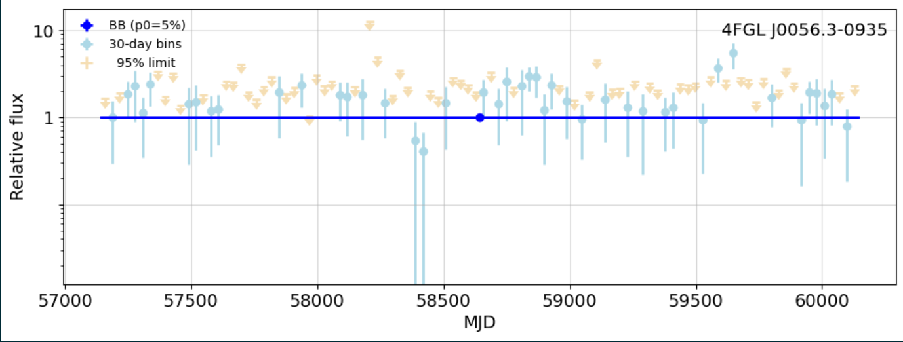
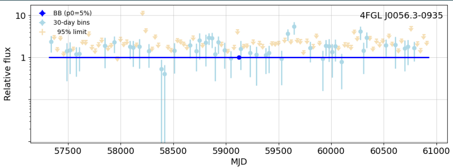
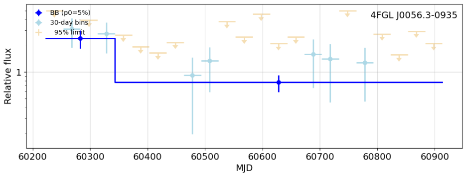

This was the output for an interval total of 3000
# Create a fixed-interval partition

This was for a total of 4000. only one block was detected

And this was for a total of 1400. This time two blocks were located, implying that as the sample size shrinks the limits for detection increase. Plans to investigate more later in the week
