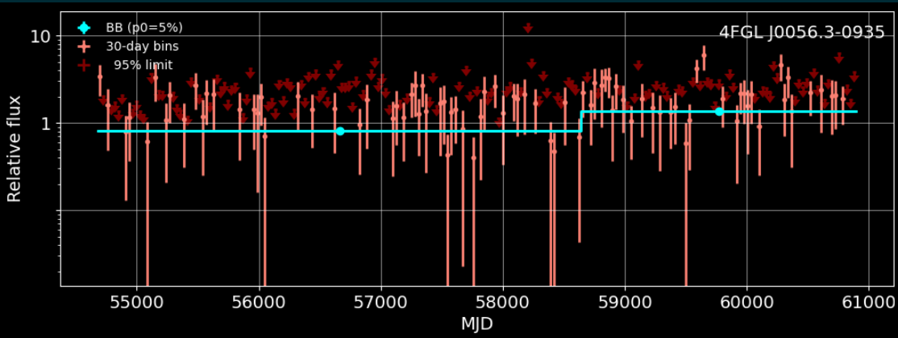
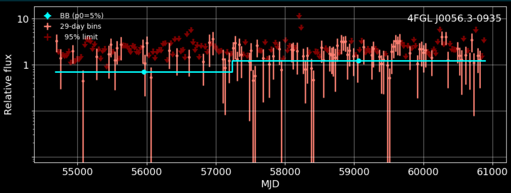
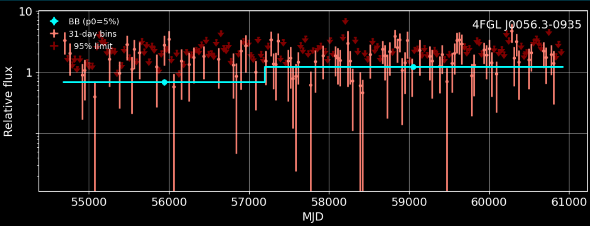
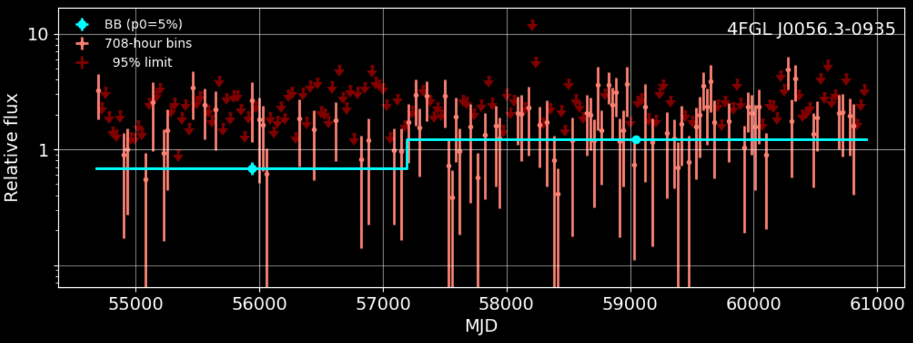
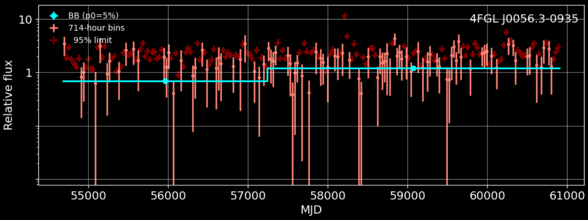

# Evaluating Error in Bayesian Block Testing Through Interval Variations
## The Issue
It is as of yet unknown how much error (especially related to false positives) is present in the analysis. It's incredibly hard to determine due to minimal other data sources to compare to and it being a new work in general. 
## Potential Solution
One potential solution is running comparison tests on the same source multiple times. Specifically observing the interval length. The initial test would be run on a given object with a given interval, say, 30 days. Then a large number of trials will be done with a number of intervals averaging on 30 days. This information will then be added to a dataframe and the measures of center will be compared from there. 

## Major Interesting Point
The number of days for each bayesian block very much impacts the location of the step. For instance, changing the selected 30 day blocks by plus or minus 1 day gives these three graphs

### Base: 30 Days

Single step observed at MJD 58643.0, 
ratio 1.67
### 29 Day Bins

Single step observed at MJD 57235.0, 
ratio 1.74
### 31 Day Bins

Single step observed at MJD 57194.0, 
ratio 1.76

The difference between 31 and 30 was **1449 MJD**, and **1408 MJD** between 29 and 30. Interestingly, both 29 and 31 day bins have a step that comes earlier than that of the 30 day binning. Because the jump is slightly smaller in the 29 day bins, that is what I elected to use to continually shrink the difference between them and attempt to find if there is a certain point where a major shift is made, or if the difference decreased linearly.

## Bins in between 29 and 30 days

### 29.5 Day Bins

Single step observed at MJD 57190.5, 
ratio 1.76

The difference between the MJD of the step of 30 and 29.5 is actually very slightly LARGER than that of the 30 and 29 day bins, being **1452.5 MJD**. This either suggests an incredibly non-linear relationship, or an error in the code when it comes to dealing in floats. First, let's shrink the margin more. 

### 29.75 Day Bins

Single step observed at MJD 57241.5, 
ratio 1.75

This time it is a difference of **1401.5 MJD**. Exactly 6.5 MJD smaller of a difference than the initial 29-30 difference. But, progress is still progress. 

At about 29.9 days, the difference increases again, then decreases once more. The sheer variability in these results is frankly kind of insane, and I think it may suggest an issue with floats more than anything else. Future plans are to try this with a larger base bin size and see if differences stepping down by 1 day are the same, or if it's a percent of the base that causes those numbers. Or even if larger bin size means a more consistient change in the decrease 
